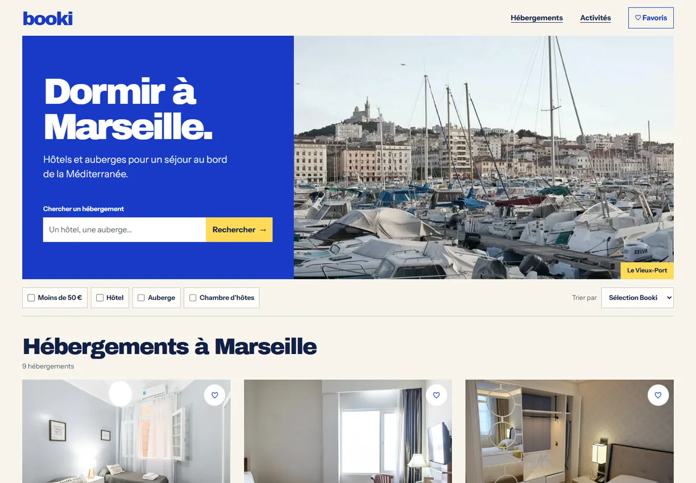

# Booki

J’ai repris mon projet OpenClassrooms pour en faire un petit guide de séjour à Marseille. On peut chercher un hébergement, filtrer par type ou par prix, puis garder des adresses en favoris. Les photos viennent du projet d’origine.

[Version du projet d’origine sur GitHub Pages](https://drgyz.github.io/Yazan-Booki/)



## Lancer le site

```sh
python -m http.server 5173 --bind 127.0.0.1
```

Ouvrez [localhost:5173](http://localhost:5173). Le site utilise HTML, CSS et JavaScript et se sert directement depuis le dépôt.

## Vérifier le catalogue

```sh
npm run verify
```

Les filtres sont dans l’URL pour pouvoir partager une recherche. Les favoris sont enregistrés dans le navigateur. Les tarifs et les notes viennent du catalogue de démonstration.
